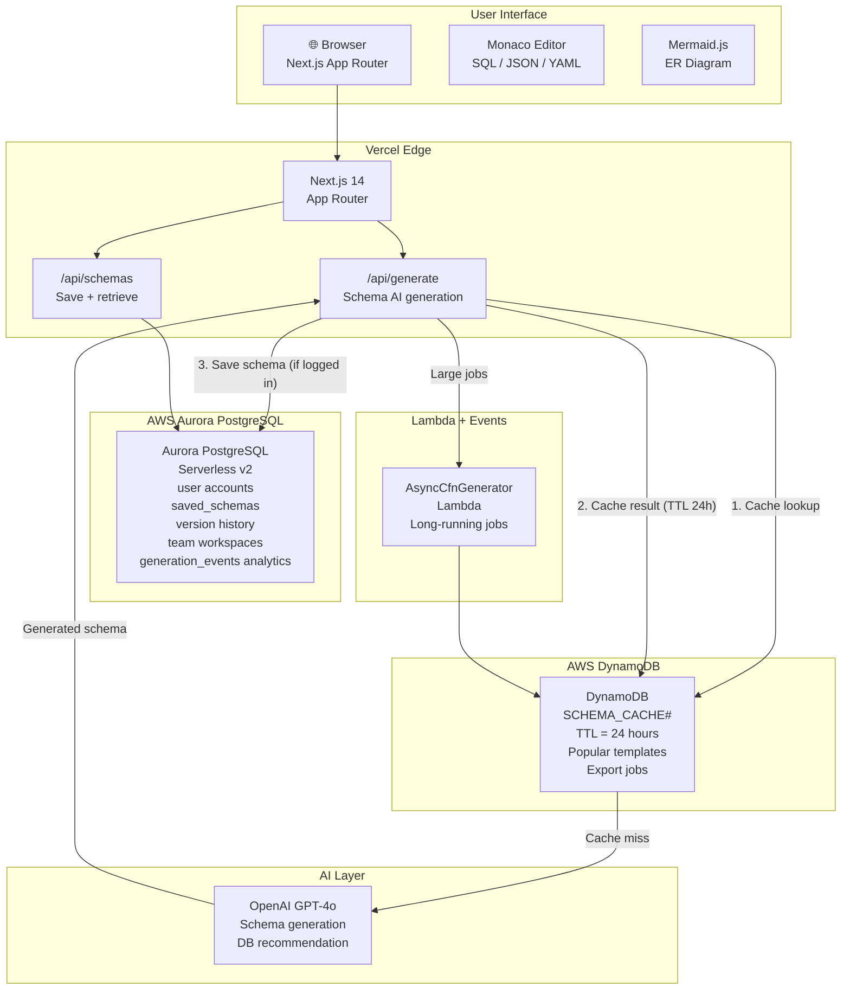
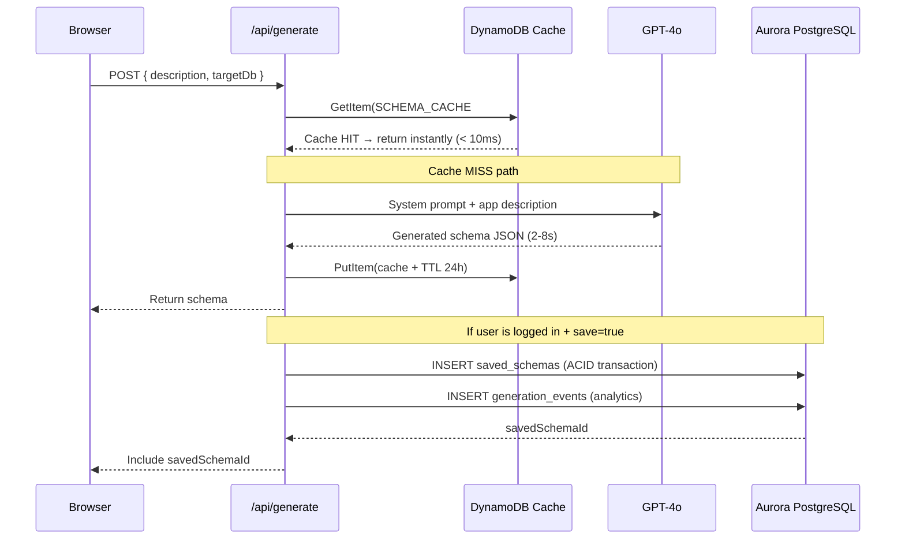

# SchemaForge — Architecture

## System Overview

SchemaForge is an **AI-powered AWS database schema designer** built with **polyglot persistence** —
Aurora PostgreSQL and DynamoDB used together, each for what it does best.



---

## Why Polyglot Persistence?

SchemaForge demonstrates the **exact same decision** we help users make:
use the right database for the right job.

| Data | Database | Why |
|---|---|---|
| User accounts, saved schemas | **Aurora PostgreSQL** | Relational — users JOIN schemas JOIN teams; ACID version history; SQL analytics |
| Schema version history | **Aurora PostgreSQL** | Self-referential tree (parent_id), recursive CTEs, ACID transactions on version number |
| Team collaboration | **Aurora PostgreSQL** | Row-level security per team; complex queries across member lists |
| AI generation cache | **DynamoDB** | Key-value cache pattern; TTL auto-expiry; O(1) reads; on-demand scaling for variable load |
| Popular templates | **DynamoDB** | High-read counter pattern; simple GSI access; no joins needed |
| Export job tracking | **DynamoDB** | Event-driven job status; simple jobId→status lookup |

---

## Aurora PostgreSQL Schema

```
users ──── team_members ──── teams
  │
  └── saved_schemas ──(parent_id)── saved_schemas (version history)
        │
        └── schema_comments
              └── users

generation_events ← analytics (userId, dbType, cacheHit, latencyMs)
```

**Key Aurora features used:**
- Recursive CTE for version history tree traversal
- `TIMESTAMPTZ` for correct timezone handling
- GIN index on `tags[]` array column
- Row-level security (team isolation)
- `platform_stats` view for homepage metrics
- Serverless v2 (0.5–16 ACU) — scales to zero between usage

---

## DynamoDB Single-Table Design

| Entity | PK | SK | Key Attributes |
|---|---|---|---|
| Schema Cache | `SCHEMA_CACHE#<sha256>` | `DATA` | `generatedSchema`, `expiresAt` (TTL), `cachedAt`, `hitCount` |
| Popular Template | `POPULAR#<dbType>` | `TEMPLATE#<type>` | `accessCount`, `lastAccessedAt` |
| Export Job | `EXPORT_JOB#<jobId>` | `STATUS` | `status`, `cfnYaml`, `completedAt` |

**Key DynamoDB features used:**
- TTL (`expiresAt`) — auto-expiry of 24h cache entries without cron jobs
- On-demand billing — variable cache traffic, no pre-provisioning
- Deterministic cache key: `SHA-256(prompt + targetDb)` — identical prompts always hit cache

---

## AI Generation Flow



---

## Scalability

| Dimension | Approach |
|---|---|
| AI API cost | DynamoDB cache eliminates duplicate GPT-4o calls for identical prompts |
| Aurora scale | Serverless v2 scales 0.5→16 ACU; scales to zero during off-hours |
| DynamoDB scale | On-demand — auto-scales for any cache traffic pattern |
| Cold start | Aurora minimum 0.5 ACU keeps warm; DynamoDB always warm |
| Global | Aurora read replicas for read-heavy production; DynamoDB Global Tables for cache |

---

## Security

| Control | Implementation |
|---|---|
| Auth | NextAuth.js Google OAuth, session-based |
| Database access | Aurora: VPC private subnets, security groups; DynamoDB: IAM role policies |
| Secrets | AWS Secrets Manager; no credentials in code or environment variables in prod |
| Schema isolation | All queries scoped to `userId`; team schemas scoped to `teamId` with RLS |
| Input validation | Zod schema validation on all API routes; max prompt length 2000 chars |
| OWASP | SQL via parameterized queries (postgres.js); no dynamic SQL construction |
